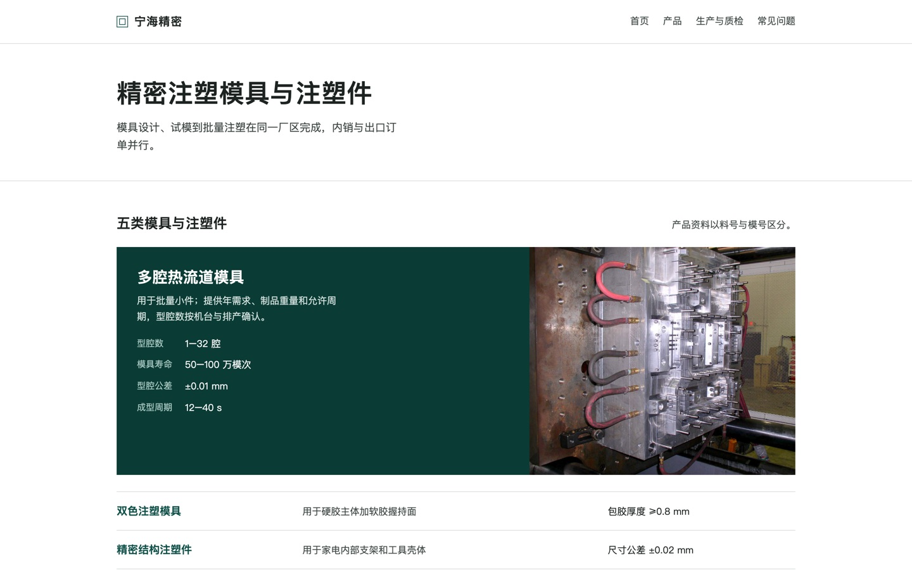
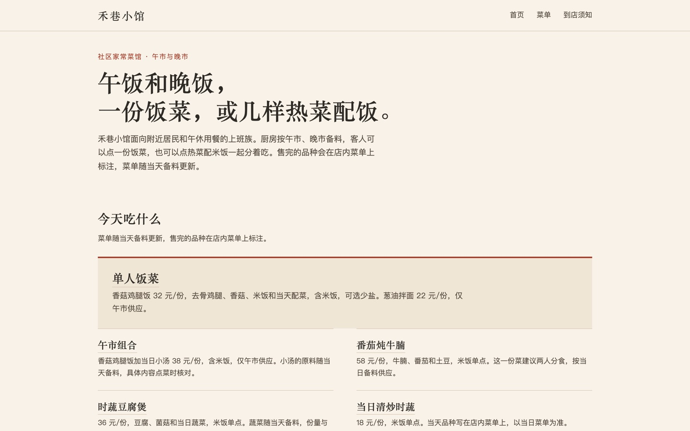
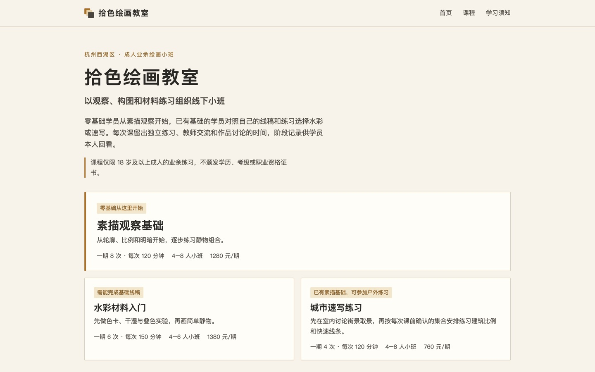
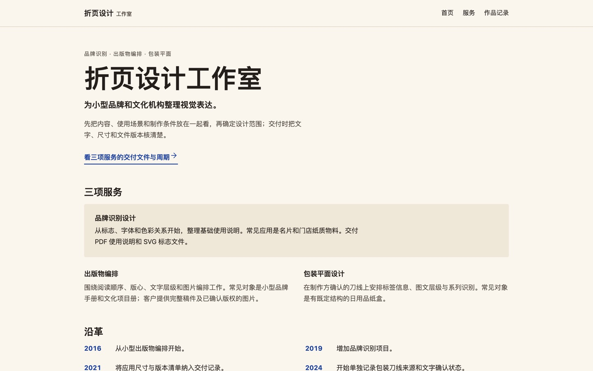

# SiteCraft

把一家公司的资料写成它自己的官网：上传公司介绍、价目表或产品说明，或者直接描述想要的网站，选一种风格，SiteCraft 写出一套多页展示型官网；不满意的地方在对话里说，或在预览上直接批注。

- 产品页：<https://sitecraft.luckye.online>
- 工作台演示：<https://sitecraftapp.luckye.online>，按步骤回放模拟资料「禾巷小馆」的一次真实生成和两轮批注修改。演示是静态页面，使用预设数据，不调用模型。要真正生成网站，请按下文在本地运行，并填写你自己的模型接口。

| 精密工程（注塑模具） | 品牌画册（社区餐馆） |
| --- | --- |
|  |  |
| 现场实拍（绘画教室） | 邻里日常（设计工作室） |
|  |  |

样品均由模拟资料生成，公司与店铺并不存在；完整样品站在 [landing/samples/](landing/samples/)，各自附图片署名与许可。

## 能做什么

- **从资料到网站**：给资料或一句话需求 → 选风格（精密工程、现场实拍、品牌画册、邻里日常，或「帮我选」），用两个滑杆调版式与疏密 → 确认页面大纲 → 生成整站。资料撑不起的页面会直接说明，不拿空壳凑数。
- **修改**：在对话里提要求，或在预览上点选、圈选某一块写意见，几条一起发送；改动只落在选中的区块。快捷按钮：更大胆、更克制、精简文字、换个版式。
- **版本**：每次修改都存成完整版本，可撤销、恢复任一旧版本，刷新后从当前版本继续。
- **名称与失败续跑**：公司、企业、机构使用同一主体名称确认；缺失或冲突先确认。已写好的整站或单页修改候选在检查失败后保留，可点击「继续检查已生成的页面」；刷新不自动调用模型，续跑不重复写页，仍须通过全部检查后才保存版本。
- **英文版**：中文站定稿后再生成，沿用同一结构只翻译文字，数字、型号、邮箱和网址逐项核对。
- **下载站点包**：当前版本导出为静态 ZIP（中英文页面、实际用到的图片和 `LICENSES.txt`），可放到自己的服务器上。
- **底线检查**：生成、对话、批注、恢复都经同一个提交入口。价格、时间、资质、承诺、效果、客户与评价必须能在资料里找到原句，否则写「待补充」；页面没有脚本、外部资源、未授权图片和空链接；375／768／1440 三档不横向溢出、不遮挡、正文对比度达标。不过关就交回模型修，最多两轮，仍不过如实说明，不保存。

## 用你自己的模型接口

项目不提供模型 key。在本地运行后打开「工作区设置 → 模型接口」，填写 API 地址、key 和模型名（目前只保证 DeepSeek 兼容接口，例如 `https://api.deepseek.com` 与 `deepseek-flash`）。

- 接口设置只保存在你的浏览器（localStorage），只在需要调用模型的请求里经请求头发给本机服务；服务只在处理那一次请求时使用，不写盘、不记日志。服务只连接 https 公网地址，不跟随重定向。
- 开发模式下，站点、版本和对话保存在项目的 `.sitecraft-data/` 目录。

项目方向、决定和待办见 [.project-map/MAP.md](./.project-map/MAP.md)，术语见 [CONTEXT.md](./CONTEXT.md)，协作规则见 [AGENTS.md](./AGENTS.md)。

## 本地运行

负责人实际服务运行在 Windows 的 `D:\sitecraft-ai`，通过 `ssh win-lan` 维护，地址为 [http://localhost:3100](http://localhost:3100)（Windows 本机）。使用 Docker Desktop 的 Linux 容器，构建也在 Windows 完成。启动、停止、更新和双卷备份见 [Windows Docker 运行说明](deploy/docker/README.md)。模型接口在浏览器设置中填写；健康检查不要求服务端模型 key。

Compose 只启动 web 与 PostgreSQL：数据库保存对话、对齐状态和批注，文件卷保存站点代码、完整版本、资料、模型任务和上传。数据库不开放宿主端口，web 默认只绑定回环。它复用现有存储实现，与下述浏览器存储模式分别运行。

以下是直接使用 Node 的开发方式：

需要 Node 22 和一个 Chrome：提交入口用它在 375／768／1440 三档下检查页面，推荐 [chrome-headless-shell](https://developer.chrome.com/blog/chrome-headless-shell)。

```bash
git clone https://github.com/a1024053774/sitecraft-ai.git
cd sitecraft-ai
npm ci
CHROME_PATH=/path/to/chrome-headless-shell npm run dev
```

打开 [http://localhost:3000](http://localhost:3000)，用 Chrome 查看生成站：部分内置浏览器会拦截沙箱 iframe。

开发模式（`SITE_STORE=fs`，默认）把站点存在 `.sitecraft-data/`，并提供 `/published/<siteKey>` 发布页。模型接口可以在设置页填写，也可以写进 gitignore 的 `.env.local`（只在非生产模式读取）：

```env
DEEPSEEK_BASE_URL=https://api.deepseek.com
DEEPSEEK_API_KEY=server-only-secret
DEEPSEEK_MODEL=deepseek-flash
```

浏览器存储模式（T-202）：站点、版本、对话、批注和上传的资料只长期保存在浏览器（IndexedDB），服务器只在临时数据根保留打开中的副本，闲置 30 分钟或重启即删除；不提供发布链接，改为下载站点包。在本机这样运行：

```bash
SITE_STORE=browser npm run build
SITE_STORE=browser SITECRAFT_DATA_ROOT=/tmp/sitecraft-server-copy CHROME_PATH=/path/to/chrome npm start
```

`SITECRAFT_DATA_ROOT` 必须是单独的临时目录（服务器启动时会清空其中的站点副本），不能用 `.sitecraft-data`。会话与批注在开发模式仍支持 PostgreSQL（`SITE_STORE=postgres`）。普通开发或离线导入可用 `SITECRAFT_DATA_ROOT` 指定数据根目录；测试存储须使用显式且经 health 核对的临时数据根或其子目录，否则在读写前拒绝。HTTP 请求不能修改数据根。

显式新建入口为 `/workspace?new=1`，创建 API 只收 `name`。没有站点参数的工作台让用户选站点，不读取或新建共享的默认草稿。

## 检查

```bash
npm run typecheck
node --test --experimental-strip-types scripts/t167-runner-regressions.ts
CHROME_PATH=/path/to/chrome-headless-shell npm test
npm run build
```

`next-env.d.ts` 由 Next 的 dev、build 或 typegen 生成，不纳入 Git；首次只运行类型检查时，先执行 `npx next typegen`。

`npm test` 每轮创建独立的临时 `SITECRAFT_DATA_ROOT`，自启本工作树随机端口 dev server，把同一数据根与 `SITECRAFT_BASE` 传给测试进程，并在任何测试模块载入前核对 health、登记本轮存储许可。测试服务独用 `.next-test` 构建目录，可与同目录使用 `.next` 的普通 dev 服务共存，不改变普通服务的端口。它清除继承的 `NODE_TEST_CONTEXT`，按 Node 每文件统计记录实际执行数，零用例即失败；入口沿项目内运行时引用及子进程本地脚本静态识别浏览器入口并打印依据，不维护文件名单；非浏览器池保持默认并发，浏览器池固定文件并发为 2，每文件每轮只跑一次，两池合并原生统计，任一池失败即整轮失败。最终候选在主线执行一次完整全量；票内明确要求多轮时按票执行；非浏览器池按进程祖先采样 Chrome 并记录所属测试文件，仅告警，不改分池、统计或通过条件；全量自然跑完后再判断是否停止下一项；不沿用已有服务或数据根，不加载 `.env.local`，不配置真实模型。日志、身份、统计和数据根路径保存在 `artifacts/t167/test-run-*/`；其中 `checks/` 记录动态范围检查与 CDP 方法的起止、计数、分段耗时，不记录请求参数或页面正文。清理根绑定入口脚本所在工作树，cwd 不一致即拒绝；从清理、登记直到本轮结束持有工作树独占锁，锁按行保存 pid 和启动时间；存活持有者仍直接拒绝并报告 pid 与路径，pid 已退出或记录不可解析时可以接管残留锁。并发接管通过同一文件的完整原子追加登记，首个存活声明获得锁，其余明确拒绝，不等待或重试。新一轮开始前按时间保留最近五轮（含新一轮，不分成败），窗口外仅删除成功目录；失败或报告不完整的旧目录继续保留并输出路径，因此目录总数可能超过五个。T-130 临时夹具位于本轮数据根的 `t130/`。启动失败同时报告 Next 原因与日志路径，临时数据保留供核查。定向检查用 `npm test -- tests/<用例>.test.ts`；原始 `node --test` 没有已核对的数据根时，存储模块在读写前拒绝。上面的入口回归命令不开 Chrome，应与全量串行执行，其中普通 dev 共存用例自行启停自己的普通服务。

存储路径在各 store 保持可静态分析，`storageGuard` 只核验许可；测试身份的动态路径显式退出 Turbopack 部署追踪，避免未知目录被扩展追踪后撞上目录符号链接。构建回归使用实际项目的既有目录结构：`node --experimental-strip-types scripts/t167-build-trace-regression.ts --project <项目绝对路径>`；它运行 `SITE_STORE=fs npm run build`，在既有 `artifacts/` 结构下要求构建成功，不删除或移动该目录。

英文版的本地 HTTP 模型替身全链检查：`CHROME_PATH=/path/to/chrome-headless-shell node --experimental-strip-types scripts/check-english.mjs`。它独占 3161、使用独立的 artifacts 数据目录，运行后保留报告与截图，不调用真实模型。真实英文质量与独立审核的状态见 T-151。

新路线评估集（七家模拟公司 × 两种默认风格，中文整站；`--only` 可筛选已登记风格）在已配置 DeepSeek、`SITE_STORE=fs` 的本机服务上运行：

```bash
CHROME_PATH=/path/to/chrome-headless-shell SITECRAFT_BASE=http://127.0.0.1:3142 npm run eval:new-route
```

日常验证加 `-- --quick`：工业/精密工程、外贸/现场实拍、注塑/精密工程、纸包装/现场实拍四个组合，仅生成首页和产品页。整轮仍用于质量决策；快速档只和同档、同资料的轮次比较，不把页数变化带来的用量下降当作成对质量证据。可用 `node --experimental-strip-types scripts/analyze-code-usage.ts <轮次目录>` 只读拆分各阶段的输入、输出和已报告的推理用量，不调用模型。真实运行前先估算用量并取得主控放行。

输出在 `artifacts/t130/round-<时间>/`：`command.sh` 是可重跑的命令，`private/` 保存底线检查、逐轮拒收率、耗时、用量和匿名映射，`review/mixed/` 与 `review/company/` 是两个互不引用的盲评包，分别交给不同的新评审实例；跨轮比较另在 `comparison-review/`，也单独评阅。每个包都有自己的提示词。不要把其他包、`private/` 或命令一起交给评审。默认和最近同资料轮次比较，亦可加 `-- --previous <上一轮目录>`。失败轮次保留；上游报错不重试，不用假模型替代。`-- --prepare-only` 只准备公开官网对照截图和提示词，不能用作生成验收。本地开发使用默认 Turbopack，例如 `npm run dev -- --hostname 127.0.0.1 --port 3142`。

## 旧站导入与素材

批准的旧演示站通过离线导出的中文 home 进入第一个版本，保留原区块顺序；旧英文只归档。导入经 `commitSiteCode` 清理和全部确定性检查，作者显示「旧站转换」，事实状态显示「旧站转换未做模型校对」。检查失败只保存可见失败元数据，不存版本；已有记录不覆盖。

```bash
CHROME_PATH=/path/to/chrome-headless-shell SITE_STORE=fs SITECRAFT_BASE=http://127.0.0.1:3154 node --experimental-strip-types scripts/import-legacy-site-code.ts --input exported-candidates.json --out new-import-report.json
```

输入是已导出的候选数据，CLI 不读写旧 JSON，也不调用模型；批准范围与正式主数据写入/清理门见 [T-145](.project-map/tickets/T-145-remove-old-route.md)。系统不自动清理数据。含用户上传且未转换的旧站以明确状态保留。

图片、字体、图标、商标分别核验许可，无授权图片用无图版。模拟照片和系统图标的许可记录保留，代码许可不能替代素材许可。本项目自身暂未声明开源许可证。

T-148 提供可选的系统抽象底图：`bd_` 编号只作背景，不能当产品或现场照片；提交入口核对登记、用途、加载与叠底对比度。72 张三档 WebP 与登记表已静态入库，预览和发布不加载 shader 库。`shaders@4.0.4` 只在 devDependencies，来源、参数、主控选用与排除理由见 [SOURCE.md](resources/shader-backdrops/SOURCE.md)。重新离线渲染用空闲的 3158 和一个新输出目录：

```bash
CHROME_PATH=/path/to/assigned/chrome-headless-shell node scripts/render-shader-backdrops.mjs artifacts/t148/new-render --install
```

仅主控已选定的配置可入库；脚本用硬件 WebGPU 定格导出，单张上限 200KB，失败不会换渲染路径，已有证据目录不会覆盖。`--install` 同时更新 `public/system-backdrops/` 静态素材和 `lib/code-site-backdrops.ts` 登记表。浏览器测试需指定 CHROME_PATH 与本工作区的 SITECRAFT_BASE，事实模型使用本地夹具的测试不代表真实模型能力。

公开部署见 [deploy/vps/](deploy/vps/)：单机 nginx + Cloudflare Tunnel，产品页为 `landing/`，工作台演示为 `demo/`，两者都是静态目录，服务器上不运行建站服务（T-207）；静态响应设置 `no-transform`，保留示例邮箱原文。演示由 `scripts/t207-build-demo-stages.mjs` 和 `scripts/t207-capture-demo.mjs` 从一次真实生成的记录截取。`deploy/kubernetes/` 是早期的多实例示例，不用于当前部署。
